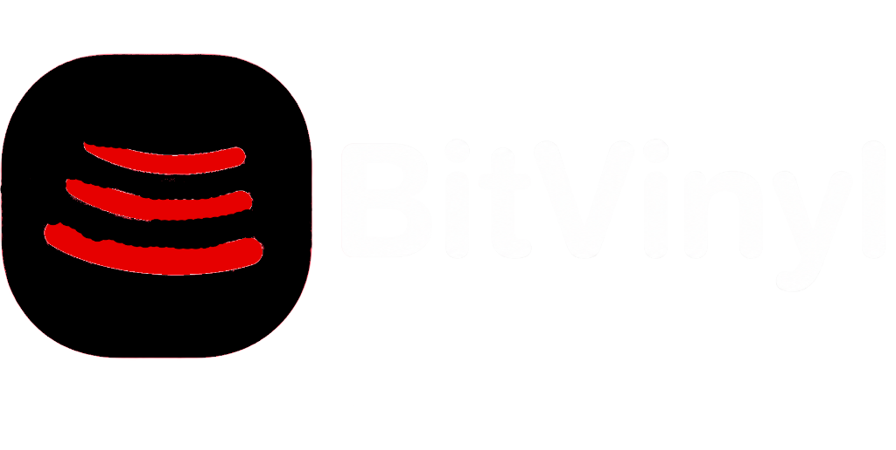
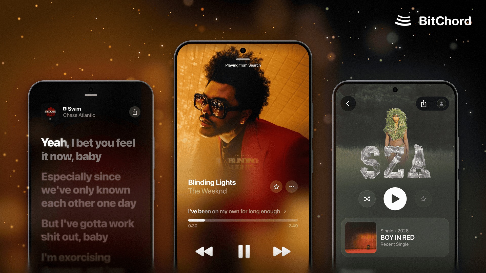

 
 

# BitVinyl

### Your music. Your collection. Your way.

*An aesthetic, extensible music player for Android phones.*

 

 

[**Download**](#download) · [**Features**](#features) · [**Contributing**](#contributing) · [**Attribution**](#attribution) · [**Disclaimer**](#disclaimer)

> [!IMPORTANT]
> BitVinyl is an independent fork based on [BitChord](https://github.com/kushagrasinghx/BitChord) by Kushagra Singh. It is not affiliated with, endorsed by, or connected to YouTube, Google, or upstream BitChord. Use it at your own discretion.
>
> *Note on Brand Assets:* Current `Banner.png` is an upstream placeholder asset pending updated BitVinyl banner artwork.

---

<h1>Features</h1>

<table>
  <tr>
    <td width="50%" valign="top">

#### Playback & Sound
- **Search, browse and play** anything available on YouTube Music.
- **Hi-Res lossless audio** — FLAC/ALAC from configured module sources, with YouTube Music fallback.
- **Bit-perfect USB exclusive output** — sends lossless audio directly to USB DACs without mixing or resampling.
- **Gapless playback with true crossfade**, adjustable 0–12s.
- **Automix [Beta]** — DJ-style transitions with beat-matching and tempo-stretching.
- **System equalizer** and internal parametric tone shaping.
- **Background playback** with Media3 foreground media session and notification controls.

#### Downloads & Local Library
- **Custom Downloader & yt-dlp integration** for high-quality downloads and MP3 conversion.
- **Metadata & album artwork embedding** (ID3, MP4, FLAC Vorbis comments).
- **Custom download folder selection** via SAF and direct storage paths.
- **Automatic `.thumbnails` folder caching** for fast, offline artwork loading.
- **Offline playlists & synchronized LRC lyrics export**.
- **Local music scanning** for device audio, USB OTG, and network drives (SMB & WebDAV).

    </td>
    <td width="50%" valign="top">

#### Experience & Interface
- **Dynamic, artwork-driven theming** — Material 3 palette extracted from album art.
- **Frosted-glass UI** — translucent glass surfaces via Haze.
- **Apple-like lyrics animation** and word-by-word synchronized highlighting.
- **Phone-first Material 3 UI** — rich gestures, home screen widget, and Android Auto support.
- **Listening Replay** — detailed stats on your top songs, artists, and listening trends.

#### Connectivity & Accounts
- **Google account sign-in** for personal YouTube Music library and mixes.
- **Listen Together** — synchronized real-time group listening with friends.
- **Spotify integration** — import and match public playlists.
- **Discord Rich Presence** — display current track and status on your profile.
- **Scrobbling** to Last.fm and ListenBrainz.
- **Pluggable source addons** — modular sources for external audio streaming.

    </td>
  </tr>
</table>

---

<h1>Download</h1>

Grab the latest signed Android phone APK from the [Releases](https://github.com/jackedhawk-117/BitVinyl/releases) page (e.g., `BitVinyl-prod-arm64-v8a-release.apk` for modern Android phones, or `BitVinyl-prod-universal-release.apk`). Sideloading requires enabling "Install unknown apps" for whichever browser or file manager you download it with.

---

## Migrating from BitChord

BitVinyl uses its own application ID (`com.jackedhawk117.bitvinyl`), so it installs alongside BitChord rather than replacing it. Because Android isolates private app data between different application IDs, app-private preferences and encrypted credentials cannot migrate automatically.

1. **Export a backup in BitChord:** Open **Settings → Backup & Restore → Export** to save your `bitchord-backup-*.json` file.
2. **Import into BitVinyl:** Open **Settings → Backup & Restore → Import** in BitVinyl and select the exported backup file to restore your settings, search history, and Replay listening stats.
3. **Sign in again:** Authentication credentials (YouTube Music, Last.fm, ListenBrainz, Discord, Spotify) are excluded from backups and must be configured again.
4. **Re-add custom sources:** Any custom source addons or modules may need to be added again.
5. **Local downloads:** Existing music saved in `Music/BitChord` remains discoverable automatically alongside new downloads in `Music/BitVinyl`.

---

<h1>Contributing</h1>

We welcome contributions to BitVinyl! Please review our [Contributing Guide](CONTRIBUTING.md) and [Code of Conduct](CODE_OF_CONDUCT.md) before submitting a Pull Request.

[**Contributing Guide**](CONTRIBUTING.md) · [**Code of Conduct**](CODE_OF_CONDUCT.md) · [**Maintainers**](MAINTAINERS.md) · [**Additional Docs**](ADDITIONAL.md)

---

<h1>Attribution & Upstream</h1>

BitVinyl is developed by [@jackedhawk-117](https://github.com/jackedhawk-117) and is based upon the excellent open-source work of [BitChord](https://github.com/kushagrasinghx/BitChord) created by Kushagra Singh ([@kushagrasinghx](https://github.com/kushagrasinghx)).

We gratefully acknowledge all upstream contributors and libraries that make this project possible:
- Lyrics animations: [binimum/am-lyrics](https://github.com/binimum/am-lyrics)
- Lyrics providers: [lrc.red](https://lrc.red), [BiniLyrics](https://github.com/binimum), [BetterLyrics](https://github.com/better-lyrics/better-lyrics), [PaxSenix](https://lyrics.paxsenix.org), [LyricsPlus](https://github.com/ibratabian17/YouLyPlus), [SimpMusic](https://github.com/maxrave-dev/SimpMusic), [LRCLIB](https://lrclib.net), [Musixmatch](https://www.musixmatch.com), [Genius](https://genius.com)
- USB DAC implementation reference: [Mornye](https://github.com/mornyeapp/Mornye)

---

<h1>Disclaimer & Legal Notice</h1>

BitVinyl is an independent, community-driven third-party audio player and client. It is **not** associated with Google LLC, YouTube Music, Deezer, Telegram, or any of their parent companies.

* **No Media Hosting:** BitVinyl does not host, upload, or store copyrighted music files. It operates strictly as an interface to scan local device storage or stream media directly from public, public-facing, or user-authenticated APIs.
* **Fair Use & API Usage:** This software is created solely for personal research, educational, and fair-use purposes. The user is entirely responsible for ensuring their usage aligns with their local copyright laws and YouTube Terms of Service.
* **Copyleft:** BitVinyl is free software under the GNU General Public License v3.0 (GPLv3). Any distribution must include the Corresponding Source under the same license.

---

<h1>License</h1>

This project is licensed under the **GNU General Public License v3.0 (GPLv3)**. See the [LICENSE](LICENSE) file for details.

