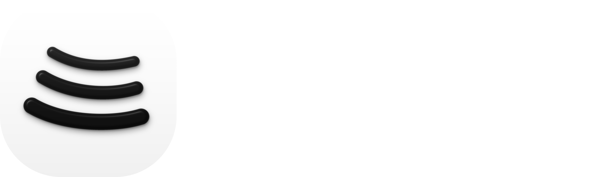
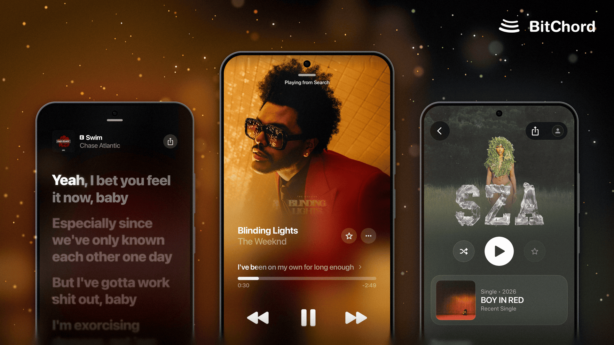

 
 

# BitChord

### Aesthetic YouTube Music Client

 

 

[**Download**](#download) · [**Features**](#features) · [**Contributing**](#contributing) · [**Support**](#support) · [**Disclaimer**](#disclaimer)

 

> [!IMPORTANT]
> BitChord is not affiliated with, endorsed by, or connected to YouTube or Google in any way. Use it at your own discretion.

---

<h1>Features</h1>

<table>
  <tr>
    <td width="50%" valign="top">

#### Playback
- **Search, browse and play** anything available on YouTube Music.
- **Hi-Res lossless audio** — FLAC/ALAC from a configured module source, with YouTube Music as fallback.
- **Gapless playback with true crossfade**, adjustable 0–12s.
- **Automix [Beta]** — DJ-style transitions with beat-matching and tempo-stretching.
- **Offline downloads** — save tracks with embedded metadata.
- **Local music library** integration.
- **Background playback** via a proper foreground media session.
- **BitChord TV & Android TV** — Leanback interface with lossless audio upgrade support for TV music video playlists (see [ISSUES.md](ISSUES.md)).
- **Apple-like lyrics animation** — credit to [binimum](https://github.com/binimum/am-lyrics).

#### Connectivity & Accounts
- **Sign in with your Google account** for personalized content.
- **Spotify integration** — connect your account to play your playlists and Liked Songs.
- **Discord Rich Presence** — in-app login, live track/artist/album and progress.
- **Scrobbling** to Last.fm and ListenBrainz.
- **Pluggable sources** — add, edit, test and health-check module sources.

    </td>
    <td width="50%" valign="top">

#### Experience
- **Animated album canvas** — motion artwork on the now-playing screen.
- **Word-synced lyrics** — word/syllable-level highlighting from multiple sources.
- **Lyrics providers** — credit to [lrc.red](https://lrc.red), [BiniLyrics](https://github.com/binimum), [BetterLyrics](https://github.com/better-lyrics/better-lyrics), [PaxSenix](https://lyrics.paxsenix.org), [LyricsPlus](https://github.com/ibratabian17/YouLyPlus), [SimpMusic](https://github.com/maxrave-dev/SimpMusic), [Unison](https://unison.boidu.dev), [Megalobiz](https://www.megalobiz.com), [KuGou](https://www.kugou.com), [LRCLIB](https://lrclib.net), [Musixmatch](https://www.musixmatch.com) and [Genius](https://genius.com).
- **Dynamic, artwork-driven theming** — Material palette extracted from album art.
- **Frosted-glass UI** — Telegram-style translucent bars via Haze, Material 3 theming.

#### Controls & Tweaks
- **Per-network audio quality** — separate quality ceilings for Wi-Fi and mobile data.
- **Playback speed control** (0.5×–2.0×) and **skip silence**.
- **Sleep timer** — fixed presets or "stop after this track".
- **System equalizer** integration.
- **Bit-perfect USB exclusive output** — sends lossless tracks to a USB DAC unchanged, at each track's own rate and bit depth. Thanks to [Mornye](https://github.com/mornyeapp/Mornye) for the reference.
- **Stats for nerds** — codec, bit depth, sample rate, and more on the now-playing screen.

    </td>
  </tr>
</table>

---

<h1>Download</h1>

Grab the latest signed APK from the [Releases](https://github.com/kushagrasinghx/BitChord/releases) page. Sideloading requires enabling "Install unknown apps" for whichever app you download it with.

### BitChord TV Fork Enhancements (mandy321/BitChord)

This fork ([mandy321/BitChord](https://github.com/mandy321/BitChord)) adds exclusive features to BitChord TV and the core playback engine that are not available in the upstream release:

#### 1. Live Source Health Check & Quality Tier Ranking
- **Concurrent Source Probing ("Test / Refresh")**: Concurrently tests configured audio sources with a 4-second timeout, immediately displaying reachability, response latency, and connection status.
- **Intelligent Quality Tier Detection**: Automatically classifies streams into weighted quality ranks:
  - **Rank 4**: Dolby Atmos / Hi-Res FLAC (multichannel / 24-bit masters)
  - **Rank 3**: Hi-Res FLAC (24-bit 96–192kHz uncompressed studio masters)
  - **Rank 2**: Lossless FLAC (16-bit 44.1kHz CD quality)
  - **Rank 1**: High Quality (320kbps audio)
- **One-Click Auto-Prioritize**: Sorts active sources by quality tier rank first, then by lowest latency (fastest response first), maintaining optimal audio fidelity.

#### 2. Music Video to Studio Lossless Master Upgrade
- **Autonomous Video-to-Studio Resolution**: Removed the restriction that forced official music videos to play in lossy Opus format. YouTube Music video rows (e.g., `Because Of You (Official HD Video)`) automatically match against lossless studio audio and stream the uncompressed master.
- **Intro/Outro Duration Slack (90s)**: Accounts for video-exclusive storytelling, spoken dialogue, and end credits while maintaining strict artist, title, and version integrity.

#### 3. Advanced Metadata & Fuzzy Matching Engine
- **Packaging vs. Identity Separation**: Strips promotional tags (`[Official HD Video]`, `[Lyric Video]`, `(From "OST")`, `Full Song`) while strictly preserving bidirectional version markers (`Remix`, `Live`, `Acoustic`, `Instrumental`).
- **Unicode & Script Transliteration**: Full NFKC Unicode normalization, case/accent folding, and Hepburn Romaji transliteration for Japanese Kana/Kanji and non-spaced CJK titles.
- **Composer vs. Vocalist Dual Query**: Resolves Indian film and soundtrack discrepancies where YouTube lists the composer (e.g., *Pritam*) while streaming stores list the vocalist (e.g., *Neeraj Shridhar*), using exact duration corroboration to guarantee master identity.

#### 4. Real-Time Measured Stats for Nerds (Default ON)
- Direct telemetry read from the ExoPlayer/Media3 hardware sink displaying active codec (`FLAC`, `ALAC`, `Dolby Digital Plus (E-AC3 JOC)`, `Opus`, `AAC`), bit depth (16/24-bit), sample rate (44.1–192 kHz), bit rate (kbps), and serving provider.
- Differentiates between what the source *claimed* and what the hardware decoder *measured*.

#### 5. Audiophile-Grade Default Configuration
- **Normalization (Sound Check)**: Renamed to **"Normalization"** in Settings and defaulted to **OFF** to preserve untouched, bit-exact sample playback.
- **Clean Signal Path**: Automix (OFF), Crossfade (0s), Equalizer (OFF), Spatial Audio (OFF), USB DAC (OFF), Autoplay (ON), Dolby Atmos (ON).

#### 6. Interactive TV Scrobbling (Last.fm & ListenBrainz)
- **Direct TV Authentication**: Built native Leanback dialogs for signing into Last.fm and ListenBrainz directly on the TV interface.
- **Last.fm Credentials or Session Key**: Supports standard username/password login (`auth.getMobileSession`) or direct Session Key (`sk`) entry (convenient via Google TV / Fire TV mobile remote apps).
- **Custom API Key Support**: Expandable drawer to enter or override Last.fm API Key & Secret if running a custom build without environment secrets.
- **ListenBrainz Token Integration**: Direct input for ListenBrainz user tokens.
- **Live Account Status & Control**: Displays connected usernames, one-click disconnect, and independent toggles for track scrobbling, "Now Playing" broadcast, and primary artist filtering.

#### 7. Motion Artwork Source Prioritization (Apple Music vs. Spotify Canvas)
- **Apple Music Motion Art Default**: Prioritizes official, studio-commissioned Apple Music HLS motion covers by default across both TV and mobile.
- **Interactive Source Switcher**: Added a direct "Motion Art Source" row in TV Settings (`Apple Music` ↔ `Spotify Canvas`) and a quick toggle under Animated Cover Art in Mobile Settings, giving users instant control over their visual playback experience.

#### 8. BitChord Connect (Spotify Connect-Style TV Remote Playback)
- **Local LAN Discovery & Remote Control**: Automatically discovers running BitChord TV instances (Amazon Fire TV Stick, Google TV, Android TV) on the local Wi-Fi network without complex pairing or pairing codes.
- **Synchronized Playback & Queue Handoff**: Tap the Audio Output icon in Mobile Now Playing to seamlessly transfer playback from phone to TV at the exact millisecond.
- **Bi-Directional Remote Controls**: Phone acts as an interactive remote controller for TV playback (Play/Pause, Next/Prev, track seek scrubbing, and volume controls).
- **Intelligent Pause-on-Switch & Disconnect**: Automatically sends `ACTION_PAUSE` to previous remote devices when switching between TV targets or handing back to the phone, preventing overlapping audio.
- **Leanback TV Notification**: TV displays an elegant animated connection banner (`Connected to <Phone>`) when controlled by mobile.

### BitChord TV & Lossless Audio Upgrade
BitChord TV is optimized for Android TV and Fire TV devices with Leanback navigation and autonomous lossless playback:
- **BitChord Connect Server:** Built-in embedded control server and mDNS broadcaster for wireless phone-to-TV streaming control.
- **High-Fidelity Lossless Playback:** Seamless streaming of studio-quality uncompressed audio up to 24-bit / 192 kHz.
- **Smart Video-to-Audio Drift Compensation:** Automatic handling of video intro/outro duration drift (up to 90 seconds) for music videos such as Rihanna's *Diamonds* and Justin Bieber's *Love Yourself*.
- **Sub-15ms Cold-Load Home Feed:** Instant disk caching for all Home feed rows.
- **Targeted Architecture Builds:**
  - **BitChord TV (`BitChordTV-*.apk`):**
    - `arm64-v8a`: 64-bit Android TVs and streaming boxes (NVIDIA Shield, NVIDIA Shield Pro, Sony Bravia 4K).
    - `armeabi-v7a`: 32-bit Android TVs and streaming sticks (Amazon Fire TV Stick 4K / Max, Google TV TCL, Chromecast with Google TV).
    - `universal`: Universal TV build compatible with any Android TV hardware.
  - **BitChord Mobile (`BitChord-App-*.apk`):**
    - `arm64-v8a`: Modern 64-bit Android smartphones and tablets (Samsung Galaxy S23, Google Pixel, OnePlus).
    - `universal`: Universal mobile build compatible with any Android phone or tablet.
- Detailed architecture and resolution notes are documented in [ISSUES.md](ISSUES.md).

---

<h1>Contributing</h1>

We welcome contributions to BitChord! Please review our [Contributing Guide](CONTRIBUTING.md) and [Code of Conduct](CODE_OF_CONDUCT.md) before submitting a Pull Request.

[**Contributing Guide**](CONTRIBUTING.md) · [**Code of Conduct**](CODE_OF_CONDUCT.md) · [**Maintainers**](MAINTAINERS.md) · [**Additional Docs**](ADDITIONAL.md)

### Thanks to all contributors ❤

---

<h1>Support</h1>

BitChord is free and always will be — if it's earned a spot in your rotation, you can chip in here:

 

---

<h1>Disclaimer & Legal Notice</h1>

BitChord is an independent, community-driven third-party audio player and client. It is **not** associated with Google LLC, YouTube Music, Deezer, Telegram, or any of their parent companies.

* **No Media Hosting:** BitChord does not host, upload, or store copyrighted music files. It operates strictly as an interface to scan local device storage or stream media directly from public, public-facing, or user-authenticated APIs.
* **Fair Use & API Usage:** This software is created solely for personal research, educational, and fair-use purposes. The user is entirely responsible for ensuring their usage aligns with their local copyright laws and YouTube Terms of Service.
* **No Ad-Blocking Guarantee:** While BitChord focuses on providing a clean listening environment, it does not guarantee permanent bypasses or modifications to commercial third-party platform conditions.
* **Copyleft:** BitChord is free software under the GPLv3. The license does not let anyone forbid others from selling or redistributing copies, but any distribution must come with the Corresponding Source under the same license.

---

<h1>License</h1>

This project is licensed under the **GNU General Public License v3.0 (GPLv3)**. See the [LICENSE](LICENSE) file for details.

